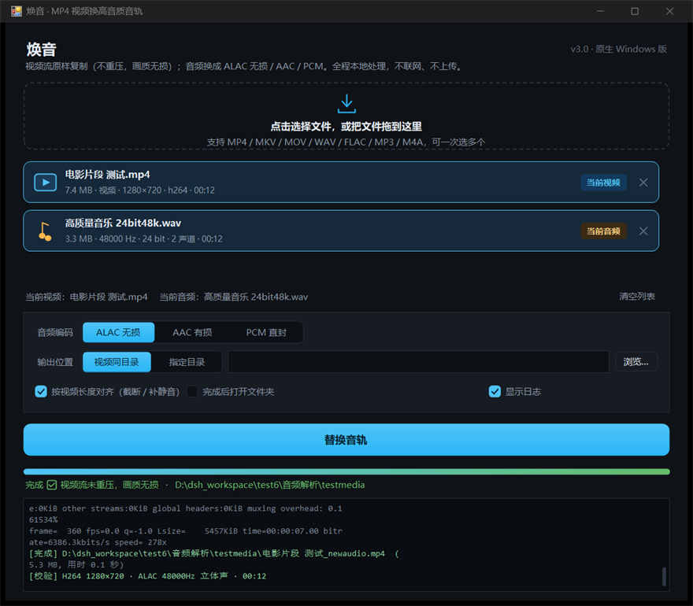
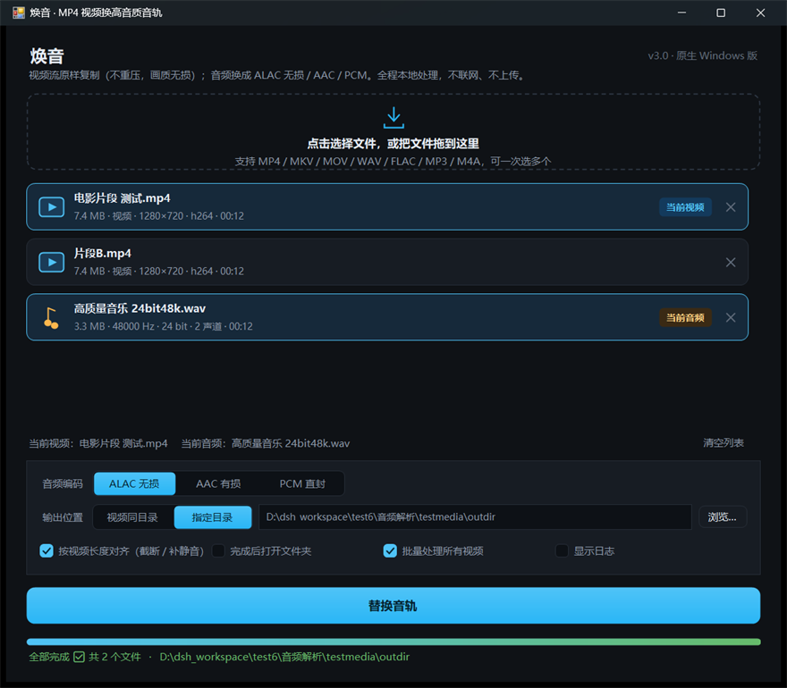
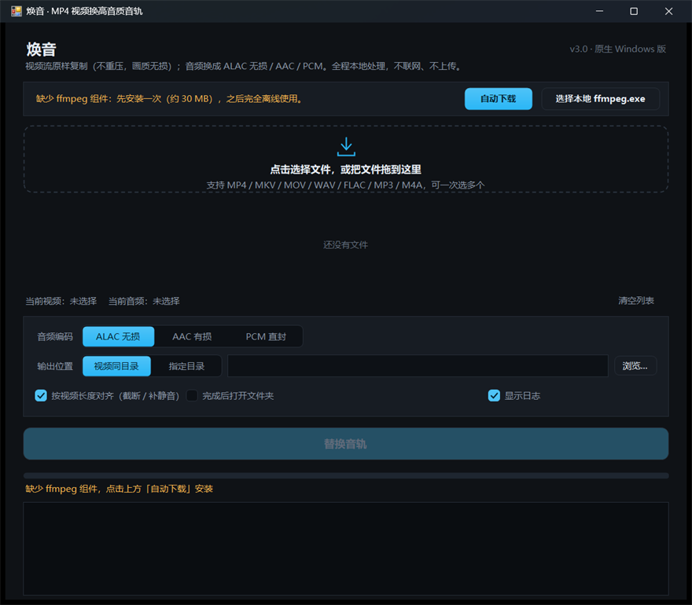

# 焕音 · MP4 视频换高音质音轨（原生 Windows 版）

把视频里那条低码率音轨换成高质量音轨（WAV / FLAC / ALAC…），**画面原样复制、一个像素都不重压**。

「焕音」是对网页版「音轨替换器 V2」的重做：不再是 `启动.bat` + PowerShell 本地服务 + 浏览器页面，而是一个**真正的 Windows 桌面程序**——单个 exe，双击即用，没有浏览器、没有 CMD 窗口、没有本地端口。

**本项目完全开源，让更多喜欢 ASMR 的朋友减少技术困扰。**
换音轨这件事本来不该是门槛：一段好的 ASMR 素材，配上一条 24bit 无损音轨，戴上耳机才听得出差别。所以这个工具开源、免费、不联网、不加水印、不设次数限制，源码就在这个仓库里，谁都可以自己看、自己改、自己编译。

[](https://github.com/yugegezhenshuaia/huanyin/releases)
[](LICENSE)

---

## ⬇️ 快速下载

点名字直接下（文件来自本仓库的 Releases，**每个版本单独存档，旧版本永远保留**，想回退随时下）：

| 版本 | 文件 | 大小 | 下载 |
|---|---|---|---|
| **焕音 v3.0** | 单文件版（内置 ffmpeg，**完全离线**，推荐） | ≈30 MB | **[⬇ 焕音 v3.0 · 单文件版](https://github.com/yugegezhenshuaia/huanyin/releases/download/v3.0/HuanYin-v3.0-standalone.exe)** |
| **焕音 v3.0** | 轻量版（首次联网装 ffmpeg，体积小） | ≈200 KB | **[⬇ 焕音 v3.0 · 轻量版](https://github.com/yugegezhenshuaia/huanyin/releases/download/v3.0/HuanYin-v3.0-lite.exe)** |
| **焕音 v3.0** | 源码包（含编译脚本，可自己构建） | ≈70 KB | **[⬇ 焕音 v3.0 · 源码](https://github.com/yugegezhenshuaia/huanyin/releases/download/v3.0/HuanYin-v3.0-source.zip)** |

> - 下载到的文件名带版本号，比如 `HuanYin-v3.0-standalone.exe`，一眼能看出手里是哪个版本、要不要更新。
> - 历史版本都在 [Releases 页面](https://github.com/yugegezhenshuaia/huanyin/releases)，按版本号挑选即可，新版本不会覆盖旧版本。
> - 系统要求：Windows 7 SP1 及以上，自带 .NET Framework 4.5+（Win10/11 系统自带的就够）。

---

## 目录

1. [两个版本，选一个用](#一两个版本选一个用)
2. [使用教程（三分钟上手）](#二使用教程三分钟上手)
3. [选项逐条说明](#三选项逐条说明)
4. [和网页版 V2 的区别](#四和网页版-v2-的区别)
5. [ffmpeg 从哪来](#五ffmpeg-从哪来轻量版)
6. [命令行用法（可选）](#六命令行用法可选)
7. [常见问题](#七常见问题)
8. [自己编译](#八自己编译不需要-visual-studio)
9. [致谢与声明](#九致谢与声明)

---

## 一、两个版本，选一个用

上面下载表里的两个版本，**功能完全一样**，区别只在 ffmpeg 从哪来：

- **单文件版（推荐）**：ffmpeg 已经打包在 exe 里，首次运行解压到 `%LOCALAPPDATA%\HuanYin`（之后一直复用）。拷到没有网络的电脑上也能直接用，适合发给朋友、或者不想折腾的情况。
- **轻量版**：只有 200 KB，第一次使用要点一下「自动下载」联网装一次 ffmpeg（约 20～40 MB，十几秒到一两分钟），之后同样离线运行。适合自己已经有 ffmpeg、或者很在意体积的情况。

> 单文件版第二次运行就不再解压，启动速度和轻量版一样快。

---

## 二、使用教程（三分钟上手）

### 第 0 步：打开

双击 `焕音-单文件版.exe`。

- 第一次启动会花 1～2 秒把内置的 ffmpeg 解压出来（窗口顶部和底部状态栏会提示「正在解压内置 ffmpeg 组件…」），**之后就秒开**；
- 用的是轻量版（`焕音.exe`）的话，第一次会看到顶部提示「缺少 ffmpeg 组件」，点右边的 **自动下载** 即可，也可以看下面第 5 节的其他办法。

### 第 1 步：把文件加进来

两种方式，随便挑一种：

- **点最上面那个虚线大框** → 弹出选择文件窗口 → 按住 `Ctrl` 可以一次多选；
- 或者直接从资源管理器**把文件拖进窗口**（一次拖多个也行）。

支持的文件：

- 视频：MP4、M4V、MOV、MKV、WEBM、AVI、TS
- 音频：WAV、FLAC、MP3、M4A、AAC、OGG、OPUS

加进来以后每个文件会在列表里占一行，直接显示大小、分辨率或采样率/位深、时长——**先在这儿看一眼对不对**，省得跑完才发现选错文件。

### 第 2 步：指定谁是视频、谁是音频

程序不知道你想拿哪个当画面、哪个当声音，所以要点一下告诉它：

- **点一下视频那一行** → 行尾出现蓝色标签「当前视频」
- **点一下音频那一行** → 行尾出现橙色标签「当前音频」

如果列表里正好只有一个视频 + 一个音频，程序**会自动选好**，你不用管。

> 点错了？再点另一行就切过去。不想用了？点行尾的 `×` 删掉。整个列表点「清空列表」一次清空。

### 第 3 步：选音质（一般不用改）

默认就是 **ALAC 无损**，绝大多数情况直接用它：

| 选项 | 是什么 | 什么时候选 |
|---|---|---|
| **ALAC 无损** | 无损压缩，装进 MP4，主流播放器都认 | 默认，推荐。想把 CD/无损音源原样塞进视频就用它 |
| **AAC 有损** | 有损压缩，体积小 | 只想让声音比原来好听、又不想要大文件。右边可调 128/192/256/320k |
| **PCM 直封** | 完全不压缩，输出 **.mov** | 后面还要拿去剪辑/二次处理，要求零损失 |

> 源音频是 24bit 的话，选 AAC 会降到 16bit 有损，界面会提醒你；想保真就选 ALAC。

### 第 4 步：看两个勾

- ☑ **按视频长度对齐（截断 / 补静音）** —— 默认开，建议保持。
  音频比视频长就截掉多余部分，短就在结尾补静音，保证音画同步、结尾不黑屏。
- ☐ **完成后打开文件夹** —— 勾上，跑完自动弹出输出目录。

### 第 5 步：选输出位置

- **视频同目录**（默认）：输出和原视频放在一起，文件名后面加 `_newaudio`。
  比如 `电影.mp4` → `电影_newaudio.mp4`。**同名文件已存在会自动编号，不会覆盖你的东西。**
- **指定目录**：点一下就弹文件夹选择；选过之后还能点右边的 **浏览…** 再改。

### 第 6 步：开始

点下面那个蓝色大按钮 **替换音轨**（快捷键 `F5`）。

- 进度条、百分比、`已处理时长 / 总时长`、速度（如 `430x`）会实时走；
- 想中途停：点 **取消** 或按 `Esc`，会删掉半成品文件，不留垃圾。

跑完之后：

- 状态栏变绿：`完成 ✅ 视频流未重压，画质无损 · <输出目录>`
- 日志里会出现两行关键信息，**建议看一眼**：
  - `[完成] 输出路径 (体积, 用时)`
  - `[校验] H264 1280×720 · ALAC 48000Hz 立体声 · 00:12` —— 这是程序重新读了一遍输出文件，把容器里真实的编码/分辨率/时长报给你核对，不是程序"以为"的结果。



### 一次处理多个视频（批量）

列表里出现 **两个以上视频** 时，选项行会多出一个 **☑ 批量处理所有视频**：

1. 勾上它；
2. 确认「当前视频」是列表里第一个想处理的视频（音频只有一个，就是「当前音频」）；
3. 点 **替换音轨**。

程序会**按列表顺序**把这段音频依次套用到每个视频上，进度和日志里会写 `(1/2)`、`(2/2)`。跑完状态栏显示 `全部完成 ✅ 共 2 个文件`。



### 出错了看哪里

勾着 **显示日志**，**红色那一行**就是原因。最常见的几种：

| 现象 | 原因 / 怎么办 |
|---|---|
| `失败：无法识别的文件类型` | 文件其实不是视频/音频，或者扩展名被改过 |
| `Could not find tag for codec alac` | 老版本 ffmpeg 不支持 ALAC 装进 MP4，**程序会自动改用 .mov 重试**，日志里会提示，不用管 |
| `没有可用的 ffmpeg` | 轻量版还没装 ffmpeg，点顶部提示条的「自动下载」 |
| `输出文件没有生成` | 磁盘满了 / 输出目录没有写权限 |
| 进度一直不动 | 源文件在移动硬盘或网络盘上，读取慢；换个本地盘试试 |

### 按视频长度对齐没勾会怎样？

音频比视频长 → 输出时长跟着音频走，播放器里可能会看到"黑屏拖尾"；音频比视频短 → 结尾声音突然没了。所以除非你确定两段长度一致，否则**保持勾上**。

---

## 三、选项逐条说明

| 选项 | 默认 | 说明 |
|---|---|---|
| 音频编码 | ALAC 无损 | 见上面第 3 步的表格 |
| AAC 码率 | 320k | 只有选 AAC 时才出现 |
| 按视频长度对齐 | 开 | 音频过长截断、过短补静音 |
| 完成后打开文件夹 | 开 | 跑完自动打开输出目录 |
| 批量处理所有视频 | 关 | 有 2 个以上视频时才显示 |
| 显示日志 | 开 | 展开 ffmpeg 原始输出，排错用；关掉可以让列表显示更多文件 |

快捷键：`F5` 开始，`Esc` 取消。设置（编码、输出位置、勾选项、窗口大小）**都会记住**，下次打开还是上次的样子。

---

## 四、和网页版 V2 的区别

| | 网页版 V2 | 焕音（原生版） |
|---|---|---|
| 运行方式 | 双击 bat → 起 PowerShell 服务 → 打开浏览器 | 双击 exe 直接开窗口 |
| 后台进程 | CMD 窗口 + PowerShell 常驻 + 本地 HTTP 端口 | 无（关掉窗口就结束） |
| 处理引擎 | ffmpeg.wasm（浏览器里跑，单线程） | 原生 ffmpeg.exe（多核，通常快 5～20 倍） |
| 大文件 | 受浏览器内存限制，几百 MB 以上容易崩 | 只受磁盘影响，几个 GB 也可以 |
| 依赖 | 首次要下载 12 个 wasm 模块 | 无（单文件版内置 ffmpeg） |
| 输出 | 浏览器「下载」到默认下载目录 | 直接写到你指定的文件夹，可自动打开 |
| 额外能力 | — | 批量处理、进度/速度显示、任务栏进度、日志、设置记忆、拖拽、命令行模式 |

画质与音质和原版一致：视频 `-c:v copy`（码流原样复制），音频 ALAC 无损 / AAC 有损 / PCM 直封。

---

## 五、ffmpeg 从哪来（轻量版）

程序按这个顺序找 `ffmpeg.exe`，找到就用：

1. exe 同目录（可以自己放一个，便携优先）
2. exe 同目录的 `ffmpeg\bin\ffmpeg.exe`、`bin\ffmpeg.exe`
3. 程序自己的缓存 `%LOCALAPPDATA%\HuanYin\bin\ffmpeg.exe`
4. 系统 `PATH` 里的 ffmpeg
5. 单文件版内置的 ffmpeg（自动解压到上面的缓存目录）

都没有时，窗口顶部会出现提示条：



- **自动下载**：依次尝试 GitHub 加速镜像（7.1.1 官方构建）→ gyan.dev 官方 → npmmirror 国内镜像 → BtbN，某个源太慢会自动换下一个并显示进度；
- **选择本地 ffmpeg.exe**：已经有 ffmpeg 的话直接指过去；
- 也可以把 `ffmpeg.exe` **直接拖进窗口**，程序会自己收下。

> 老版本 ffmpeg（4.x）不支持把 ALAC 封装进 MP4，遇到这种情况程序会**自动改用 `.mov` 容器**并在日志里说明，音频依然是无损的。

---

## 六、命令行用法（可选）

同一个 exe 也支持和脚本/批处理配合，不弹界面：

```bat
:: 把 high.wav 换进 movie.mp4，输出 movie_newaudio.mp4
焕音-单文件版.exe --cli movie.mp4 high.wav

:: 指定输出、编码、码率
焕音-单文件版.exe --cli movie.mp4 high.wav -o D:\out\final.mp4 -c aac -b 256k

:: 其他参数
::   -c alac|aac|pcm    音频编码（默认 alac）
::   -b 320k            AAC 码率
::   --no-trim          不按视频长度对齐
::   --ffmpeg-info      显示 ffmpeg 定位结果
::   --install-ffmpeg   只安装 ffmpeg（适合先离线准备）
```

也可以把视频/音频文件直接拖到 exe 图标上，程序打开后会自动填入列表。

---

## 七、常见问题

**Q：输出文件在哪？**
默认和原视频同一个文件夹，文件名后面加 `_newaudio`。同名文件已存在会自动编号，不会覆盖。

**Q：画质真的不变吗？**
是。视频流用 `-c:v copy` 直接复制原始码流，不经过解码/编码。程序跑完会重新读一遍输出文件，把真实的编码、分辨率、时长打在日志里供你核对。

**Q：ALAC / PCM 有什么区别？**
ALAC 是无损压缩（约为 PCM 的 50～70% 体积，24bit/96k 也能装），PCM 是完全不压缩（只能放 `.mov`）。两者解码回来都和原始 WAV 一模一样。

**Q：源文件带字幕 / 多条音轨会怎样？**
字幕轨尽量原样保留；原视频里的音轨会被新音轨替换（`-map 0:v:0 -map 1:a:0 -map 0:s?`）。

**Q：为什么 MKV / WEBM 输入，输出成了 mp4？**
输出容器统一用 MP4（ALAC/AAC）或 MOV（PCM）。个别编码（某些老格式、或者 MKV 里的字幕格式）放不进 MP4 时会报错，日志里能看到具体原因。

**Q：杀毒软件报毒？**
用系统自带编译器生成的无签名 exe 偶尔会被误报。可以加白名单，或者用源码包自己重新编译（见下）。

**Q：能批量吗？能记住我的设置吗？**
能。见第 2 步的「一次处理多个视频」，设置全部自动记住。

---

## 八、自己编译（不需要 Visual Studio）

只依赖系统自带的 .NET Framework 4 编译器：

```powershell
# 轻量版
.\native\build.ps1 -NoBundle

# 单文件版（内置 ffmpeg）
.\native\build.ps1 -Payload "C:\path\to\ffmpeg.exe"
```

产物在 `dist\`。`native\make-icon.ps1` 负责生成图标，`native\app.manifest` 声明 DPI 感知和高 DPI 适配。

源码结构：

```
native\src\
  Program.cs          入口、单实例、--cli / --install-ffmpeg
  MainForm*.cs        主窗口、文件列表、执行流程、设置持久化
  Theme.cs            深色主题控件（按钮/分段选择/复选框/进度条/滚动列表）
  FileRow.cs          文件列表行
  LogView.cs          自绘日志面板（细滚动条、按级别着色）
  Media.cs            文件类型识别、WAV 头解析、ffmpeg 探测
  JobRunner.cs        ffmpeg 参数拼装、进度解析、执行与结果校验
  FfmpegSetup.cs      ffmpeg 定位、内嵌解压、多镜像下载
  Native.cs           DPI、深色标题栏、任务栏进度
native\build.ps1      编译脚本
native\app.manifest   应用清单
native\make-icon.ps1  图标生成
```

---

## 九、致谢与声明

### 致谢

**特别感谢 郭 GUO。**

「焕音」的前身——**网页版「音轨替换器 V2」**（`启动.bat` + PowerShell 本地服务 + 网页界面 + ffmpeg.wasm）由 **郭 GUO** 开源发布。本版（原生 Windows 版）是在他的功能设计、交互流程和参数思路上做的重写：把浏览器里的 ffmpeg.wasm 换成原生 ffmpeg、把本地 Web 服务换成桌面窗口，但核心做法（视频流 `-c:v copy` 不重压、音频换 ALAC/AAC/PCM、按视频长度对齐）都沿用他的方案。

没有那份开源版本，就不会有这个程序。

### 联系

有需求、意见或者发现 Bug，欢迎发邮件：

**yugegeqaq1603@163.com**

反馈时如果方便，请附上：

1. 用的是哪个版本（单文件版 / 轻量版）；
2. 出问题的那份视频/音频的编码信息（把日志里 `Stream #0:0`、`Stream #0:1` 那几行发过来就行）；
3. 日志里红字那几行。

### 其他声明

- 程序**本地处理，不联网、不上传任何文件**；只有在你点「自动下载」时才会访问镜像站下载 ffmpeg。
- 内置 / 下载的 ffmpeg 版权归 FFmpeg 项目所有，官方构建为 GPL 许可，本程序仅作音视频处理调用。
- 本程序按「现状」提供，处理前请自行备份原始素材。
